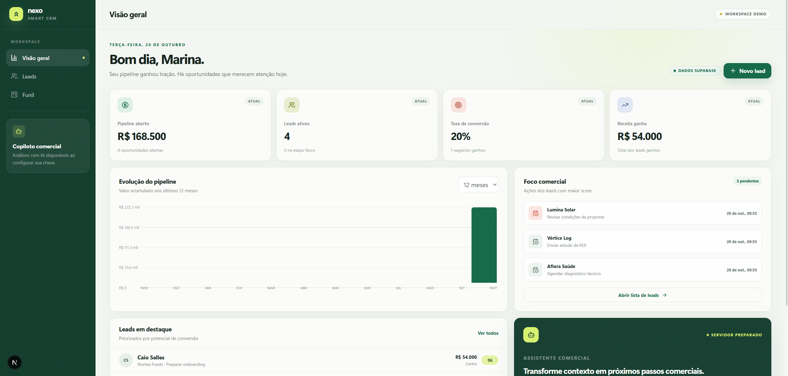
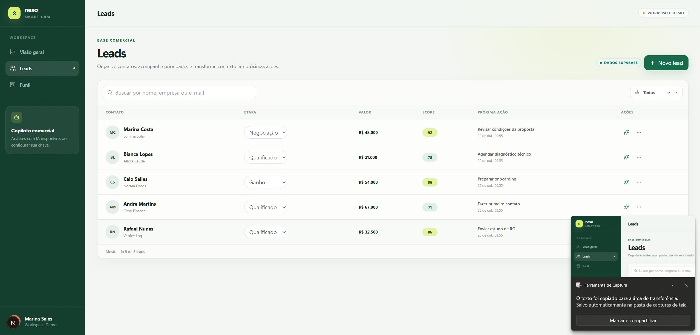
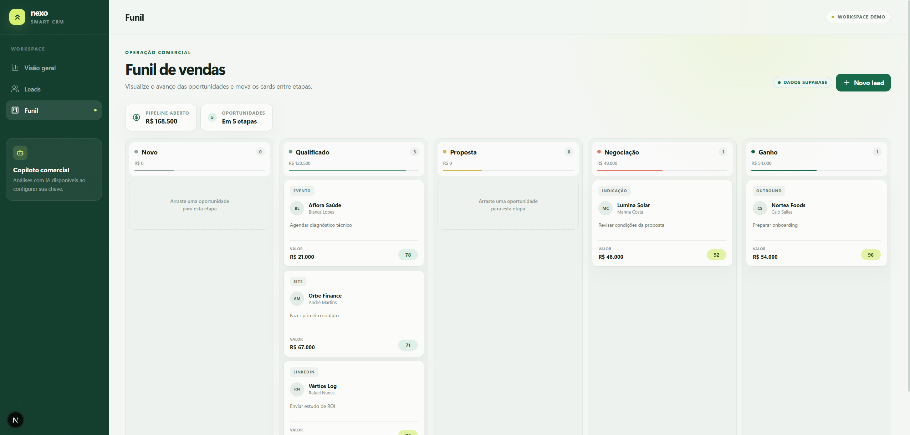
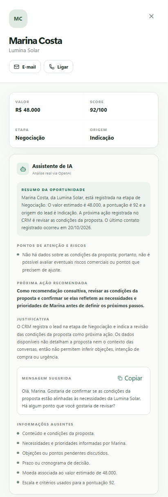
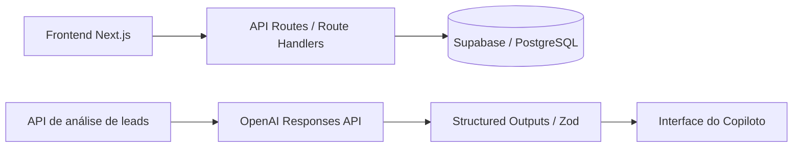

# Nexo CRM

## Apresentação do Nexo CRM

CRM inteligente para gestão de oportunidades comerciais, desenvolvido como MVP de portfólio com Next.js, PostgreSQL e inteligência artificial.

O projeto demonstra uma aplicação full-stack funcional: os leads são persistidos no Supabase, o dashboard é calculado a partir dos dados reais do banco, o funil atualiza as etapas das oportunidades e o Copiloto Comercial analisa o contexto disponível usando a OpenAI Responses API.

> Este é um projeto demonstrativo executado localmente, não um produto comercial ou serviço publicado. Pessoas, empresas, contatos, valores e oportunidades apresentados nas imagens e no seed são fictícios.

## Problema que o MVP resolve

Equipes comerciais pequenas frequentemente distribuem informações entre planilhas, anotações e ferramentas desconectadas. Isso dificulta visualizar o pipeline, priorizar oportunidades e definir o próximo contato.

O Nexo CRM concentra esse fluxo em uma experiência única:

- registra e organiza leads;
- apresenta indicadores comerciais derivados do banco;
- permite acompanhar oportunidades em um funil visual;
- transforma os dados disponíveis em recomendações comerciais estruturadas.

## Screenshots do sistema

As imagens abaixo foram capturadas com a aplicação em execução, conectada ao Supabase e utilizando os cinco registros fictícios de [`supabase/seed.sql`](supabase/seed.sql).

### Dashboard comercial



Visão consolidada do pipeline, receita ganha, taxa de conversão e ações prioritárias calculadas a partir dos leads persistidos.

### Gestão de leads



Tabela responsiva com busca, filtro por etapa, score, valor estimado, próxima ação e acesso às operações de edição e análise.

### Funil de vendas



Kanban em cinco etapas com movimentação persistida no PostgreSQL e visão do valor acumulado em cada estágio.

### Copiloto Comercial com OpenAI

<p align="center">
  
</p>

<p align="center"><em>Análise real gerada pela OpenAI a partir dos dados disponíveis no CRM, com riscos, recomendação, justificativa, mensagem sugerida e limitações explícitas.</em></p>

## Funcionalidades implementadas

- Dashboard com pipeline aberto, leads ativos, conversão, receita ganha e foco comercial.
- CRUD completo de leads persistido no Supabase/PostgreSQL.
- Busca e filtro por etapa.
- Funil Kanban com movimentação entre cinco estágios.
- Copiloto Comercial com resposta estruturada e validada.
- Cópia da mensagem comercial sugerida pela IA.
- Estados de carregamento, erro e mutações assíncronas.
- Interface responsiva, foco acessível e suporte a movimento reduzido.
- HTTP Basic Auth protegendo páginas e APIs durante a demonstração local.

## Copiloto Comercial com IA

O frontend envia somente o UUID do lead para `POST /api/ai/analyze-lead`. No servidor, a aplicação:

1. revalida a autorização;
2. valida o UUID com Zod;
3. busca o registro atualizado no Supabase;
4. reduz e limita os campos enviados ao modelo;
5. chama a OpenAI Responses API;
6. valida a resposta estruturada antes de exibi-la.

O contrato exige os campos:

- `summary`
- `risks`
- `recommended_action`
- `reasoning`
- `suggested_message`
- `missing_information`

A implementação usa `responses.parse()` com `zodTextFormat`, timeout de 30 segundos, ausência de retries automáticos, limite de tokens de saída e `store: false`. E-mail e telefone não são enviados ao modelo, e os campos do lead são tratados como dados não confiáveis, nunca como instruções.

Quando faltam informações, o copiloto explicita a limitação. Ele não inventa conversas, objeções, reuniões ou condições financeiras e não executa ações comerciais automaticamente.

## Tecnologias utilizadas

| Camada | Tecnologias |
| --- | --- |
| Aplicação | Next.js 16, App Router, React 19 e TypeScript |
| Interface | Tailwind CSS 4, Motion e Lucide React |
| Persistência | Supabase e PostgreSQL |
| Inteligência artificial | OpenAI Responses API e Structured Outputs |
| Validação | Zod 4 |
| Qualidade | ESLint, TypeScript e build de produção do Next.js |

## Arquitetura técnica



O `CRMProvider` centraliza o estado da interface e consome exclusivamente os Route Handlers. O navegador não acessa diretamente o banco nem a OpenAI.

### Estrutura principal

```text
app/
├── api/ai/analyze-lead/   # análise server-side com OpenAI
├── api/leads/             # CRUD server-side
├── funil/                 # Kanban comercial
├── leads/                 # gestão de leads e copiloto
└── page.tsx               # dashboard
components/                # shell, provider e componentes compartilhados
lib/                       # contratos, repositório e integrações server-side
supabase/                  # schema e seed demonstrativo
docs/screenshots/          # evidências reais da interface
```

## Decisões de engenharia e segurança

- O Supabase é a fonte principal dos dados; não existe fallback para `localStorage`.
- A service role permanece exclusivamente no servidor e nunca utiliza prefixo `NEXT_PUBLIC_`.
- Row Level Security está habilitado e nenhuma política pública irrestrita é criada.
- O proxy protege toda a aplicação e cada Route Handler repete a autorização.
- Mutações de origem cruzada são rejeitadas.
- Entradas e saídas relevantes são validadas com Zod.
- Erros retornados ao navegador e registrados no servidor são sanitizados.
- `.env.local`, dependências, builds, logs e caches são ignorados pelo Git.
- O seed evita duplicação por e-mail e utiliza o domínio reservado `.demo`.

Neste MVP, os Route Handlers usam a service role para acessar o banco. Como essa credencial ignora RLS, ela permanece atrás da autorização server-side e nunca é enviada ao navegador.

## Como executar localmente

### Pré-requisitos

- Node.js 20.9 ou superior; recomenda-se a versão LTS atual.
- Projeto Supabase.
- Chave da OpenAI para habilitar o Copiloto Comercial.

### Instalação

```bash
npm install
cp .env.example .env.local
npm run dev
```

No Windows PowerShell:

```powershell
Copy-Item .env.example .env.local
npm run dev
```

Acesse [http://localhost:3000](http://localhost:3000). O navegador solicitará as credenciais HTTP Basic configuradas.

### Banco de dados

1. Crie um projeto no Supabase.
2. Execute [`supabase/schema.sql`](supabase/schema.sql) no SQL Editor.
3. Execute [`supabase/seed.sql`](supabase/seed.sql) para inserir os cinco leads demonstrativos.
4. Preencha o `.env.local` sem versioná-lo.

### Variáveis de ambiente

```env
SUPABASE_URL=https://your-project.supabase.co
SUPABASE_SERVICE_ROLE_KEY=your-service-role-key
CRM_BASIC_AUTH_USER=nexo-admin
CRM_BASIC_AUTH_PASSWORD=replace-with-a-long-random-password
OPENAI_API_KEY=your-openai-api-key
OPENAI_MODEL=gpt-5.6-luna
```

| Variável | Uso |
| --- | --- |
| `SUPABASE_URL` | URL do projeto Supabase |
| `SUPABASE_SERVICE_ROLE_KEY` | Acesso server-side ao PostgreSQL via Supabase |
| `CRM_BASIC_AUTH_USER` | Usuário da proteção temporária |
| `CRM_BASIC_AUTH_PASSWORD` | Senha longa e exclusiva da proteção temporária |
| `OPENAI_API_KEY` | Credencial server-side para a Responses API |
| `OPENAI_MODEL` | Modelo utilizado pelo copiloto |

### Verificações locais

```bash
npm run lint
npm run typecheck
npm run build
```

## Limitações do MVP

- HTTP Basic Auth é adequado apenas como barreira temporária para uma demonstração privada e deve ser usado sobre HTTPS fora de `localhost`.
- Não existe autenticação individual, multi-tenancy ou isolamento por workspace.
- O histórico de contatos ainda não é persistido; o copiloto trabalha somente com os campos atuais do lead.
- Não há paginação ou filtros avançados para bases maiores.
- Não existe envio automático de mensagens ou execução automática das recomendações.
- A aplicação não possui deploy ou link de demonstração online.

Antes de qualquer uso público ou multiusuário, o projeto precisa de autenticação individual, autorização por workspace e políticas RLS vinculadas ao usuário.
