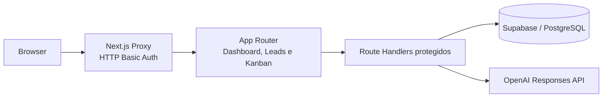

# Nexo CRM

CRM inteligente desenvolvido como projeto de portfólio para demonstrar uma aplicação full-stack com persistência real, interface responsiva e análise comercial assistida por IA.

O projeto não está publicado como serviço online. Ele foi projetado para execução local e apresentação por meio de código-fonte, documentação técnica e capturas reais da interface.

## O problema

Equipes comerciais pequenas frequentemente distribuem informações entre planilhas, anotações e ferramentas desconectadas. Isso dificulta enxergar o pipeline, priorizar oportunidades e decidir o próximo contato.

O Nexo CRM reúne essas tarefas em um MVP compacto: uma base central de leads, um funil visual, indicadores derivados dos dados persistidos e um copiloto que transforma o contexto disponível em recomendações estruturadas.

## Funcionalidades implementadas

- Dashboard com pipeline aberto, leads ativos, conversão, receita ganha e prioridades comerciais.
- CRUD completo de leads persistido no PostgreSQL.
- Busca e filtro por etapa.
- Funil Kanban com movimentação de oportunidades entre cinco etapas.
- Copiloto Comercial com análise real via OpenAI.
- Saída estruturada com resumo, riscos, ação recomendada, justificativa, mensagem sugerida e informações ausentes.
- Estados de carregamento, erro e operações assíncronas.
- Interface responsiva com navegação por teclado e suporte a movimento reduzido.
- HTTP Basic Auth como barreira temporária para a demonstração privada local.

## Tecnologias

| Camada | Tecnologias |
| --- | --- |
| Aplicação | Next.js 16, App Router, React 19 e TypeScript |
| Interface | Tailwind CSS 4, Motion e Lucide React |
| Dados | Supabase e PostgreSQL |
| IA | OpenAI Responses API e Structured Outputs |
| Contratos | Zod 4 |
| Qualidade | ESLint, TypeScript e build de produção do Next.js |

## Arquitetura



O navegador nunca acessa o banco ou a OpenAI diretamente. O `CRMProvider` consome Route Handlers do Next.js, que repetem a verificação de autorização, validam os dados e executam integrações server-side.

### Fluxo de dados

1. O frontend solicita os leads em `/api/leads`.
2. O Route Handler autorizado consulta o Supabase usando credenciais exclusivas do servidor.
3. Criação, edição, exclusão e movimentação no Kanban passam pelos mesmos contratos Zod.
4. Para uma análise, o navegador envia somente o UUID do lead.
5. O servidor busca o registro atualizado, reduz e limita os campos e então chama a OpenAI.
6. A resposta estruturada é validada antes de retornar à interface.

## Supabase e PostgreSQL

O schema em [`supabase/schema.sql`](supabase/schema.sql) cria a tabela `public.leads`, constraints de domínio, timestamps e o trigger de atualização. Row Level Security permanece habilitado e nenhuma política pública irrestrita é criada.

O seed em [`supabase/seed.sql`](supabase/seed.sql) contém cinco registros inteiramente fictícios. Os e-mails usam o domínio reservado `.demo`, e a inserção evita duplicação por endereço de e-mail.

Neste MVP, os Route Handlers usam a service role para acessar o banco. Essa chave ignora RLS e, portanto, deve permanecer exclusivamente no servidor, atrás da autorização da aplicação.

## Copiloto Comercial

A rota `POST /api/ai/analyze-lead` utiliza a OpenAI Responses API com Structured Outputs. O schema Zod exige os seguintes campos:

- `summary`
- `risks`
- `recommended_action`
- `reasoning`
- `suggested_message`
- `missing_information`

O modelo é definido por `OPENAI_MODEL`. A implementação utiliza `responses.parse()` com `zodTextFormat`, valida novamente o resultado e não apresenta respostas simuladas quando o serviço está indisponível.

Medidas adicionais incluem timeout de 30 segundos, ausência de retries automáticos, limite de tokens de saída, `store: false`, redução do contexto e instruções explícitas para tratar os campos do lead como dados não confiáveis. E-mail e telefone não são enviados ao modelo.

## Segurança e limitações

- `.env.local` e todos os arquivos `.env*`, exceto `.env.example`, são ignorados pelo Git.
- Chaves do Supabase e da OpenAI não usam prefixo `NEXT_PUBLIC_`.
- Todas as APIs revalidam HTTP Basic Auth; não dependem apenas do proxy.
- Mutações cross-site são rejeitadas.
- Entradas e saídas relevantes são validadas com Zod.
- Logs de erro são sanitizados e não incluem credenciais ou dados do lead.
- O copiloto apenas recomenda ações; ele não envia mensagens nem altera negócios automaticamente.

HTTP Basic Auth é uma proteção temporária para uma demonstração privada e deve ser usado sobre HTTPS fora de `localhost`. Antes de qualquer uso público ou multiusuário, o projeto precisa de autenticação individual, autorização por workspace e políticas RLS vinculadas ao usuário. Não reutilize credenciais reais em ambientes de demonstração.

## Executar localmente

Pré-requisitos:

- Node.js 20.9 ou superior; recomenda-se a versão LTS atual.
- Projeto Supabase.
- Chave da OpenAI para habilitar o copiloto.

```bash
npm install
cp .env.example .env.local
npm run dev
```

No Windows PowerShell, use:

```powershell
Copy-Item .env.example .env.local
npm run dev
```

Depois, acesse [http://localhost:3000](http://localhost:3000). O navegador solicitará as credenciais HTTP Basic configuradas.

### Banco de dados

1. Crie um projeto no Supabase.
2. Execute [`supabase/schema.sql`](supabase/schema.sql) no SQL Editor.
3. Para carregar os cinco registros demonstrativos, execute [`supabase/seed.sql`](supabase/seed.sql).
4. Preencha o `.env.local` sem versioná-lo.

### Variáveis de ambiente

```env
SUPABASE_URL=https://your-project.supabase.co
SUPABASE_SERVICE_ROLE_KEY=your-service-role-key
CRM_BASIC_AUTH_USER=nexo-admin
CRM_BASIC_AUTH_PASSWORD=replace-with-a-long-random-password
OPENAI_API_KEY=your-openai-api-key
OPENAI_MODEL=gpt-5.6-luna
```

| Variável | Uso |
| --- | --- |
| `SUPABASE_URL` | URL do projeto Supabase |
| `SUPABASE_SERVICE_ROLE_KEY` | Acesso server-side ao PostgreSQL via Supabase |
| `CRM_BASIC_AUTH_USER` | Usuário da proteção temporária |
| `CRM_BASIC_AUTH_PASSWORD` | Senha longa e exclusiva da proteção temporária |
| `OPENAI_API_KEY` | Credencial server-side para a Responses API |
| `OPENAI_MODEL` | Modelo utilizado pelo copiloto |

## Screenshots

As evidências devem ser capturas reais do sistema conectado aos registros demonstrativos. Os arquivos ficam em [`docs/screenshots`](docs/screenshots):

| Arquivo | Tela |
| --- | --- |
| `dashboard.png` | Indicadores e visão geral comercial |
| `leads.png` | Tabela, busca e etapas dos leads |
| `kanban.png` | Funil de vendas em cinco colunas |
| `ai-copilot.png` | Painel do lead e Copiloto Comercial |

Nenhuma imagem substituta é incluída. Consulte as instruções da pasta para reproduzir as capturas localmente sem expor credenciais.

## Verificações

```bash
npm run lint
npm run typecheck
npm run build
```

## Melhorias futuras

- Substituir HTTP Basic Auth por Supabase Auth.
- Adicionar isolamento por usuário e workspace com políticas RLS dedicadas.
- Criar trilha de atividades e histórico de contatos.
- Adicionar testes automatizados de componentes, rotas e fluxos críticos.
- Implementar observabilidade com redaction de dados pessoais.
- Adicionar paginação e filtros avançados para bases maiores.

## Escopo do portfólio

Este repositório representa um MVP demonstrativo. Pessoas, empresas, telefones, valores e oportunidades presentes no seed são fictícios e não representam operações comerciais reais.
